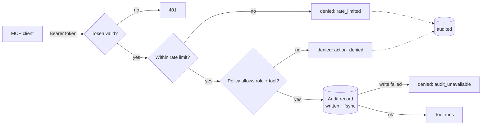

# MCP Secure Gateway

[](https://github.com/wesley-isaias/mcp-secure-gateway/actions/workflows/ci.yml)

-brightgreen)


A Model Context Protocol (MCP) server that puts every tool call behind one enforcement point: **bearer-token authentication, a deny-by-default policy, per-client rate limiting and a tamper-evident audit log**, all checked before the tool runs.

It is a small, runnable reimplementation of the principles behind [Zayuni DevWS](https://github.com/wesley-isaias/wesley-isaias/blob/main/projects/mcp.md), the MCP server I use in production to give ChatGPT and Claude controlled access to my repositories. No code or configuration from that private system is included. The tools here serve fictional data so that the security layer is the focus.

[Português abaixo](#português)

## Why

An AI agent connected to tools will eventually receive a malicious or confused instruction. Prompt filtering does not stop that. A gateway that decides **who** is calling, **what** they may do and **records** it before anything happens does. This project shows that layer in about 500 lines of Python, with 66 tests and 94% coverage.

## How a call flows



## Threat model

| Threat | Control | Where it is tested |
| --- | --- | --- |
| Unauthenticated network access | Bearer token required on HTTP; server refuses to start without a token file | `test_http.py::test_request_without_token_gets_401`, `test_server.py::test_http_without_tokens_refuses_to_start` |
| Leaked token file | File stores SHA-256 hashes only; tokens are shown once at creation | `test_tokens_and_ratelimit.py::test_token_file_never_contains_plaintext` |
| Caller escalates its own role | Role comes from the verified token or the operator, never from tool arguments | `test_server.py::test_caller_cannot_escalate_through_arguments` |
| Capability discovery | Tool listings are filtered by role: callers only see tools they may call | `test_server.py::test_tool_list_only_shows_what_the_role_may_call`, `test_http.py::test_viewer_token_does_not_see_tester_tools` |
| Unknown role or tool | Deny by default | `test_policy.py`, `test_server.py::test_unknown_operator_role_denies_everything` |
| Burst abuse | Token bucket per client, bounded memory | `test_tokens_and_ratelimit.py`, `test_server.py::test_rate_limit_blocks_bursts` |
| Silent edits to the audit trail | HMAC-SHA256 chain with sequence numbers; writer refuses to start on a broken chain | `test_audit.py` (edit, delete, reorder, forged record, wrong key) |
| Sensitive data in logs | Closed schema: no arguments, no results; clients pseudonymised with a keyed hash | `test_server.py::test_every_call_is_audited_without_content`, `test_http.py::test_audit_identifies_clients_by_pseudonym_only` |
| Action without a record | Write-ahead audit; if the write fails, the call is denied. A second record stores the outcome | `test_server.py::test_audit_failure_blocks_the_call`, `test_server.py::test_successful_call_records_outcome` |

## Quick start

Requires Python 3.11+ on Linux or macOS.

```bash
python -m venv .venv && . .venv/bin/activate
python -m pip install -e ".[dev]"
pytest -q --cov      # 66 tests, coverage gate 88%
ruff check . && ruff format --check .
```

### Local mode (stdio)

For one operator on their own machine. The role comes from the server's environment.

```bash
MCP_DEMO_ROLE=viewer mcp-secure-gateway serve
```

### Network mode (HTTP)

Token file and audit log are mandatory; without them the server exits with an error.

```bash
# 1. Create a token. The plaintext is printed once; only its hash goes in the file.
mcp-secure-gateway new-token --client-id ci-bot --role tester
#    -> save the printed JSON entry in tokens.json

# 2. Create an audit key (32+ bytes) readable only by you.
python -c "import secrets; print(secrets.token_hex(32))" > audit.key && chmod 600 audit.key

# 3. Start the server on localhost.
MCP_GATEWAY_TOKENS_FILE=tokens.json \
MCP_GATEWAY_AUDIT_LOG=audit.jsonl \
MCP_GATEWAY_AUDIT_KEY_FILE=audit.key \
mcp-secure-gateway serve --transport http --port 8000

# 4. Verify the audit trail at any time.
mcp-secure-gateway verify-audit audit.jsonl --key-file audit.key
# OK: 12 records, chain intact, last mac 3c9f...
```

Each call writes a record before it runs and another with its outcome (`succeeded` or `failed`). A record looks like this (no arguments, no results, no client name):

```json
{"client":"0a44aff966f9756b","decision":"allowed","mac":"b10a…","prev":"0000…","reason":"allowed","seq":1,"tool":"run_checks","ts":"2026-11-21T01:12:40.512+00:00"}
```

## Tools and roles

| Tool | viewer | tester | Behaviour |
| --- | --- | --- | --- |
| `list_fixtures` | allow | allow | Lists fictional record IDs |
| `get_fixture` | allow | allow | Reads one allow-listed fictional record |
| `run_checks` | deny | allow | Deterministic in-memory checks |

## Design decisions

- **One enforcement point.** All checks live in `GatewayMiddleware`, including the tool listing; tools contain only business logic, so a new tool cannot forget a check.
- **Write-ahead audit.** The record is flushed with `fsync` before the tool runs. No record means no action.
- **Hashes, not secrets, on disk.** Token file entries are SHA-256 digests, compared without early exit.
- **Fail closed at startup.** Missing token file, missing audit key, malformed entries or a broken audit chain stop the server instead of degrading silently.
- **Small dependency surface.** Security code uses the standard library (`hmac`, `hashlib`, `fcntl`); FastMCP provides the protocol.

## Limits

- **Tail truncation.** The chain detects edits, deletions, insertions and reordering, but not removal of the last lines. Production systems export periodic checkpoints (last `seq` and `mac`) to write-once storage. Zayuni DevWS does this with an R2 bucket under an indefinite Bucket Lock.
- **Static tokens.** Tokens are long-lived and revoked by removing their hash and restarting. A production deployment would use short-lived OAuth tokens, as Zayuni DevWS does with Cloudflare Access.
- **Single process.** Rate-limit state and the audit writer are per process.
- **Not a sandbox.** The tools here are harmless by design. Real tools that touch files or run commands also need OS-level isolation.

## License

[MIT](./LICENSE) © 2026 Wesley Isaias

---

## Português

Servidor MCP em que toda chamada de ferramenta passa por um único ponto de controle, antes de executar: **autenticação por token, política que nega por padrão, limite de requisições por cliente e log de auditoria à prova de adulteração**.

É uma reimplementação pequena e executável dos princípios do [Zayuni DevWS](https://github.com/wesley-isaias/wesley-isaias/blob/main/projects/pt-br/mcp.md), o servidor MCP que uso em produção para dar ao ChatGPT e ao Claude acesso controlado aos meus repositórios. Nenhum código ou configuração desse sistema privado foi incluído. As ferramentas servem dados fictícios, para que o foco seja a camada de segurança.

- **Instalar e testar:** `python -m pip install -e ".[dev]"`, depois `pytest -q --cov` (66 testes, 94% de cobertura).
- **Modo local (stdio):** `MCP_DEMO_ROLE=viewer mcp-secure-gateway serve`.
- **Modo rede (HTTP):** exige arquivo de tokens (só hashes SHA-256) e log de auditoria; sem eles o servidor não sobe. Veja os passos acima.
- **Verificar a auditoria:** `mcp-secure-gateway verify-audit audit.jsonl --key-file audit.key`.

**Limites:** a cadeia de auditoria não detecta a remoção das últimas linhas sem um checkpoint externo; os tokens são estáticos; o estado é por processo; não é um sandbox de sistema operacional.
